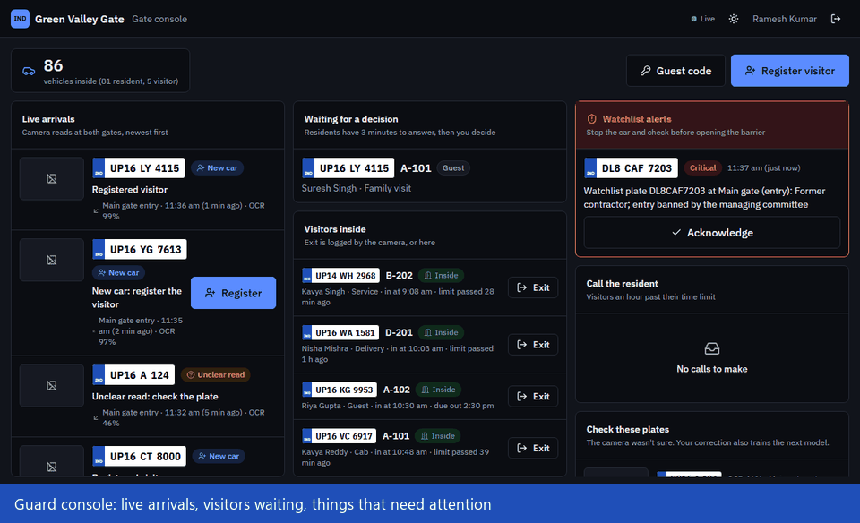
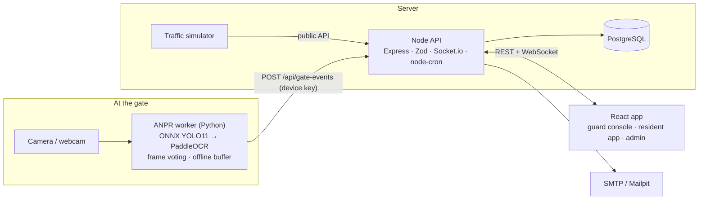
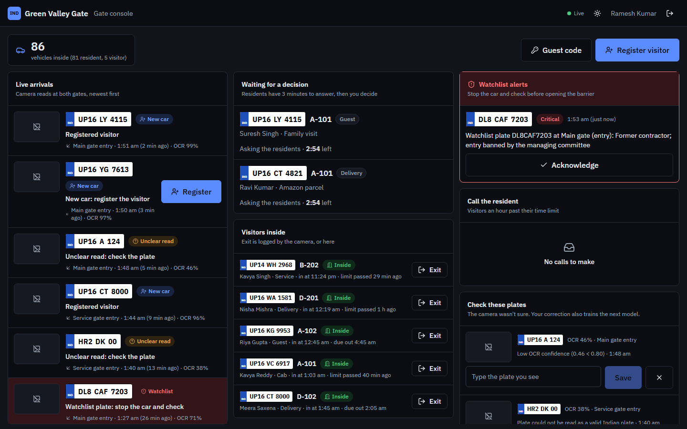
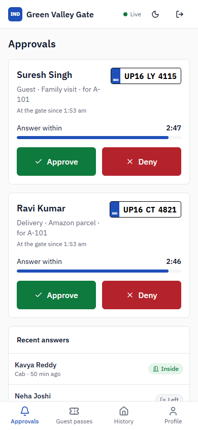
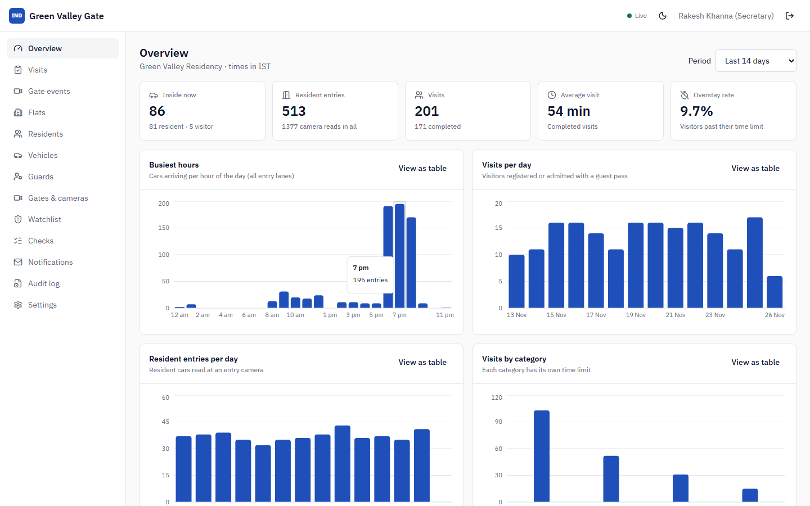

# Green Valley Gate: AI vehicle access for housing societies

[](https://github.com/Arjav122/vehicle-access-gate/actions/workflows/ci.yml)
[](LICENSE)



**A camera reads number plates so residents drive in without stopping, visitors are approved by
the resident on their phone in real time, and cars that stay too long are followed up
automatically.** Built for Indian housing societies: HSRP plates, the BH series, India time.

**Live demo:** not deployed yet. Deployment is the next step (`docs/deployment.md` has the plan).
Run it locally in two commands (see [Quick start](#quick-start)); the login page has one-click
demo logins for the **guard**, a **resident** and the **admin**.

## What it does

- **Residents drive straight in.** The ANPR worker at the gate reads the plate and the API logs
  the entry or exit, pairing every exit with its entry.
- **Unknown car → resident decides.** The guard registers the visitor in two taps, and the flat's
  residents get Approve / Deny on their phones in real time. No answer in 3 minutes → the guard
  decides.
- **Guest passes** by plate (the camera lets the car in by itself) or by an 8-character one-time
  code.
- **Time limits per visit type** (guest 4 h, delivery 20 min, cab 10 min, service 2 h), then an
  escalation ladder: email at the limit → reminder +30 min → "call the resident" task for the
  guard at +60 min.
- **Watchlist first:** banned or reported plates raise a red alert, even on an unclear read.
- **Review queue:** unclear reads go to the guard; their corrections are kept as labelled data.
- **Analytics** (busiest hours, average visit, overstay rate, frequent visitors), **nightly
  checks** for records that don't add up, an **audit log**, and **privacy controls** (masked
  phones, visitor data erased after 90 days).

## Engineering highlights

- **The camera reads, the server decides.** All plate repair lives in one pure function: the
  O↔0 / B↔8 look-alikes are fixed by position, it knows real state codes and the BH series, and
  it strips the HSRP "IND" mark. Fuzzy matching is bounded (Levenshtein ≤ 1, ambiguity → human
  review), backed by 84 table-driven tests.
- **Exactly one event per car:** an idempotency hash per read plus a 30-second debounce under a
  Postgres advisory lock. Offline-buffered reads replayed hours later stay separate events.
- **A visit state machine with one writer:** 8 statuses, 7 triggers, 10 legal moves. All 56
  (status, trigger) pairs are tested. Every change writes an append-only history row in the same
  transaction.
- **Race-safe approvals:** rows are locked `FOR UPDATE`, so two family members tapping at once
  get first-wins. The same answer twice is fine; a different answer gets 409.
- **Jobs that can't double-fire:** the escalation ladder is a pure function of a passed-in clock,
  emails go through an outbox with idempotency keys, and dispatchers claim rows with
  `FOR UPDATE SKIP LOCKED`. Running a job twice, or once after an outage, does each step exactly
  once.
- **Edge worker without PyTorch:** ONNX Runtime with a hand-written letterbox, `(1,5,N)` decode
  and NMS in NumPy; frame voting so one car means one read; a SQLite offline buffer
  (WAL, ordered replay).
- **Real time without a message bus:** Socket.io rooms, publish-after-commit, and events that
  *invalidate* client queries instead of patching copies.
- **Typed end to end:** Zod schemas generate the OpenAPI document, which generates the client's
  types. CI fails on drift.
- **A demo that keeps itself alive:** a traffic simulator drives the public API in IST
  rush-hour patterns; a nightly reset restores a known state.

## Architecture



More in [`docs/architecture.md`](docs/architecture.md), with the data model in
[`docs/database.md`](docs/database.md).

## Results

Only numbers from runs that are in this repository. Accuracy needs labelled photos, which are
not collected yet.

| What | Result | How it was measured |
|---|---|---|
| Plate detector speed (ONNX FP32, CPU) | **49.1 ms** median, 56.1 ms p95 | 200 runs on a 1280×720 frame, AMD Ryzen 7 4800H, ONNX Runtime 1.32 ([`anpr/eval/results/latency-dev-laptop.md`](anpr/eval/results/latency-dev-laptop.md)) |
| Automated tests | **615** server · **48** client · **68** ANPR · **3** browser journeys | `npm test`, `pytest`, `npm run e2e` (all in CI) |
| Server `services/` coverage | **96.6 %** lines, 86.4 % branches | Vitest + v8 (threshold 80 %) |
| Plate detection mAP | TBD | needs labelled photos ([`anpr/DATASET.md`](anpr/DATASET.md)) |
| End-to-end exact-plate accuracy | TBD | needs labelled photos ([`anpr/DATASET.md`](anpr/DATASET.md)) |

> **Detector model licence:** the plate detector is a third-party YOLO11 fine-tune
> ([DavidDrill69/yolov11-license-plate-detection](https://huggingface.co/DavidDrill69/yolov11-license-plate-detection),
> **AGPL-3.0**). It is downloaded from its publisher at a pinned commit and SHA-256 and never
> re-hosted here. A detector trained by this project would replace it (`anpr/notebooks/`).

## Tech stack

| Layer | Choices |
|---|---|
| API | Node.js 26 · TypeScript (strict) · Express 5 · Zod → OpenAPI · Socket.io · node-cron · pino |
| Data | PostgreSQL 17 · Prisma 7 (CHECK constraints and partial indexes in SQL migrations) · Supabase in production |
| Web | React 19 · Vite · Tailwind CSS 4 · Radix · TanStack Query · React Router · Recharts · openapi-fetch |
| Edge | Python 3.12 · ONNX Runtime · OpenCV · PaddleOCR · SQLite · httpx |
| Quality | Vitest · supertest (real Postgres) · Testing Library · Playwright · pytest · ESLint · Prettier · ruff · gitleaks |
| Infra | Docker Compose · GitHub Actions · Mailpit (dev email) |

## Quick start

Requirements: Docker Desktop. Optionally Node.js 24+ and Python 3.12 to run the tests and the
webcam worker outside Docker.

```powershell
docker compose up --build -d
```

```powershell
docker compose exec server npm run seed -- --reset
```

Open **http://127.0.0.1:5173** and click **Try demo as Guard / Resident / Admin**. The seed
creates "Green Valley Residency, Greater Noida": 40 flats, 60 residents, 81 cars, 14 days of
history and a live "right now" state.

| Service | URL |
|---|---|
| Web app | http://127.0.0.1:5173 |
| API docs (Swagger) | http://127.0.0.1:4000/api/docs |
| Mailpit (emails sent in dev) | http://127.0.0.1:8025 |

Keep the dashboards busy with simulated traffic:

```powershell
docker compose --profile simulator up -d
```

Read a real plate with your laptop webcam: [`docs/webcam-demo.md`](docs/webcam-demo.md).

## Screenshots

| Guard console | Resident app | Admin overview |
|---|---|---|
|  |  |  |

More in [`docs/assets/`](docs/assets/): register-visitor dialog, guard console on a phone, guest
passes, history, visits, gate events, vehicles, the overview in dark mode, landing and login.

## Project structure

```
server/   Node API: routes (thin) → services (rules) · Prisma schema + migrations · seed · simulator
client/   React app: guard console, resident app, admin dashboard · Playwright e2e/
anpr/     Python edge worker: sources → detector → OCR → tracker → client + offline buffer · eval/
docs/     architecture, database, decisions, webcam demo, study guides (learn/), screenshots (assets/)
```

## Design decisions

Every major choice (context, decision, alternatives, consequences) is in
[`docs/decisions.md`](docs/decisions.md): the Node + Python split, plate repair, debounce and
idempotency, the state machine, jobs without Redis, the frontend data flow, the simulator and
more. Study guides per phase are in [`docs/learn/`](docs/learn/); the interview guide is
[`docs/learn/INTERVIEW_GUIDE.md`](docs/learn/INTERVIEW_GUIDE.md).

## Testing

CI runs everything below on every pull request, plus a Docker Compose smoke test and a secret
scan.

```powershell
cd server; npm ci; npm run lint; npm run typecheck; npm test
```

```powershell
cd client; npm ci; npm run lint; npm run typecheck; npm test
```

```powershell
cd anpr; uvx ruff check .; uv run --no-project --python 3.12 --with pytest python -m pytest
```

The three browser journeys (resident car, visitor approval, overstay escalation) run against
the real stack: see [`client/e2e/journeys.spec.ts`](client/e2e/journeys.spec.ts) for how to
start it with short time limits, then `cd client; npm run e2e`.

## Known limitations

- **Accuracy is not measured yet:** detection mAP and exact-plate accuracy need a labelled photo
  set (`anpr/DATASET.md`). Only detector speed is reported.
- **The detector is third-party (AGPL-3.0)** and is not bundled; a self-trained model would
  replace it.
- **One server instance:** Socket.io rooms, the jobs and the debounce rely on a single process
  plus Postgres. Scaling out needs the Redis adapter and a job queue (`docs/decisions.md` D12).
- **Tokens live in localStorage** (mirrored from memory); an httpOnly refresh cookie is the
  documented alternative (D28).
- **Snapshots are stored on local disk;** S3-compatible storage is planned with deployment.
- **Demo mode makes the demo password public by design;** it is off by default and must stay
  off for a real society.
- Telegram approvals and the Hindi toggle (stretch goals) are not built.

## Future work

Multi-society tenancy · SMS / voice-call providers · native mobile apps · face recognition ·
payments · tailgating detection · a self-trained detector with measured accuracy · Prometheus
metrics and a load test.

## License

[MIT](LICENSE) for this repository's code. The default plate detector downloaded at run time is
AGPL-3.0 (see above).

## Author

Arjav Jain
