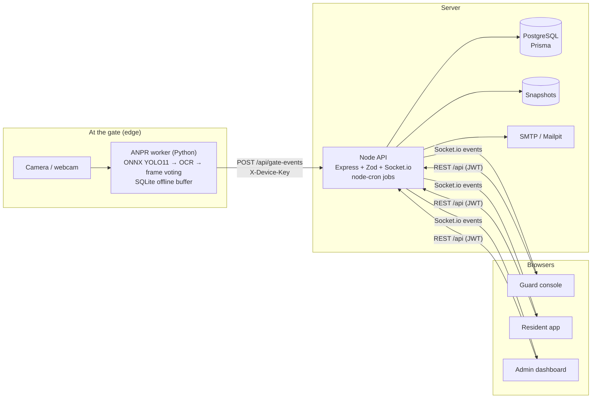
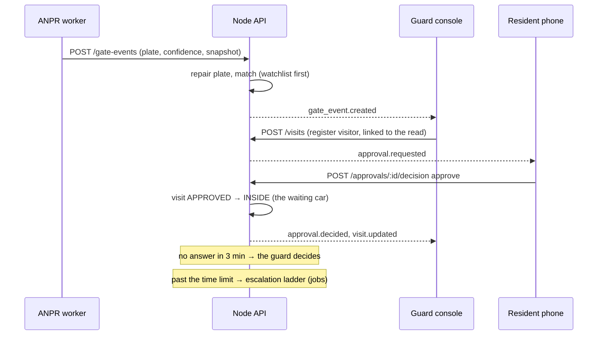
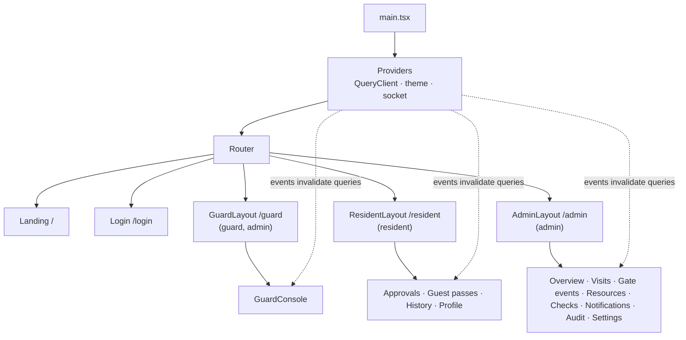

# Architecture

The camera reads, the server decides. An edge worker turns video into one plate read per car;
the Node API repairs and matches the plate, runs the visit state machine, and tells every
screen what changed. Decisions behind each part are in [decisions.md](decisions.md).

## System

| Part | Where | Job |
|---|---|---|
| `anpr/` | the gate (a laptop in the demo) | find plates, read text, vote across frames, send one read per car, buffer offline |
| `server/` | one Node process | REST API + OpenAPI docs, plate repair and matching, state machine, approvals, real time, scheduled jobs |
| `client/` | browser | guard console, resident app, admin dashboard, landing page |
| PostgreSQL | local container / Supabase | the only store; constraints and locks keep it correct |

## One car at the gate

## Server

- **Routes are thin.** Each endpoint is one `defineRoute` declaration: Zod input schemas, access
  rule, response schema. The same declaration produces validation, the RBAC check and the OpenAPI
  document (`server/src/openapi.ts`).
- **Services hold the rules** as plain functions that take a transaction: `plates.ts` (pure),
  `visitState.ts` (pure), `gateEvents.ts`, `visits.ts` (the only writer of a visit's status),
  `approvals.ts`, `guestPasses.ts`, `escalation.ts`, `notifications.ts`, `reconciliation.ts`,
  `retention.ts`, `analytics.ts`.
- **Real time = publish after commit**, to rooms `staff` and `user:<id>` (`realtime.ts`).
- **Jobs** run inside the API process with node-cron when `RUN_JOBS=true` (`jobs.ts`). Each job is
  idempotent in the database, so a restart or a double run is harmless.

## Frontend (`client/`)

| Folder | What lives there |
|---|---|
| `src/app/` | router (`App.tsx`), providers, shared app state (`state.ts`), layouts + role guard, 404 / error pages |
| `src/features/<area>/` | screens per area: `landing`, `auth`, `guard`, `resident`, `admin`, and `shared` (status badges, list helpers, hooks, snapshot image) |
| `src/components/ui/` | design-system components: button, form controls, card / badge / states, dialog, tabs / table, **PlateChip** |
| `src/lib/` | typed API client (`api.ts` + generated `schema.d.ts`), token store (`auth.ts`), socket (`socket.ts`), plate grouping, formatting |
| `e2e/` | Playwright: screenshots now, end-to-end journeys in Phase 7 |

Data flow rules:

1. **Every piece of server data is a TanStack query.** Keys start with the resource name
   (`["visits", filters]`, `["gate-events", …]`, `["inside"]`).
2. **Mutations invalidate**, they don't patch: after "Register visitor" the `gate-events`,
   `visits` and `approvals` queries refetch, so the arrival loses its Register button at once
   (no double registration).
3. **Socket events invalidate** the same keys (`lib/socket.ts` `INVALIDATES`). After a reconnect
   everything refetches.
4. **Types come from the server.** `npm run openapi` (server) writes `client/openapi.json`;
   `npm run api:types` (client) writes `src/lib/schema.d.ts`. CI fails when either drifts.

### Design system

- **Tokens:** CSS variables in `src/index.css` for background, surface, muted, border, accent and
  four state colours (ok, warn, danger, info), redefined under `.dark`. Tailwind v4 reads them via
  `@theme inline`.
- **Look:** neutral greys, one blue accent taken from the IND strip of a number plate, 1 px borders
  instead of shadows, IBM Plex Sans (self-hosted with @fontsource) with tabular numbers.
- **State is never colour alone:** green, amber and red badges always carry a word and an icon
  ("Inside", "Overstayed", "Watchlist").
- **Areas:** the guard console is dark by default with ≥ 44 px targets and at most two taps for
  common actions: three columns from 1280 px, tabs below. The resident app is mobile-first with a
  bottom tab bar. The admin dashboard has a sidebar that becomes a menu on phones.
- **PlateChip:** a mini HSRP plate (white, black border, blue IND strip, condensed bold
  characters grouped as printed). It stays white in dark mode.
- **Charts:** one series each, accent colour, recessive grid, tooltip, and a "View as table"
  switch. No dual axes.
- **Every screen** has loading skeletons, an empty state that says what to do, an error state
  with "Try again", toasts for results, and a confirmation dialog before anything destructive.

Screenshots of every main screen are in [assets/](assets/) (`npm run screenshots` in `client/`).
